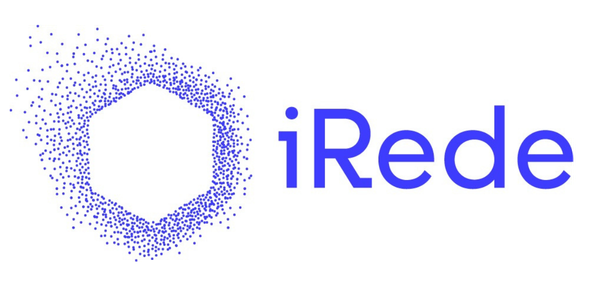

[](https://creativecommons.org/licenses/by-sa/4.0/)


[](https://github.com/carlosdelfino/irede_web3_moeda_certificado/issues)
[](https://carlosdelfino.github.io/irede_web3_moeda_certificado/)

# iRede — Certificados de Participação & iRede.c

Repositório **principal** (documentação e orquestração) do sistema de emissão
de certificados de participação dos **Residentes e Alunos do iRede**, com
registro na blockchain **Polygon** e moeda utilitária
**Utility iRede Coin (iRede.c)**.

<p align="center">
  
</p>

## Como funciona

- Cada participante recebe **certificados de participação** por etapa
  concluída, que podem ser **registrados on-chain na Polygon** (hash ancorado,
  verificação pública).
- A cada etapa, o participante ganha **iRede.c**, a moeda utilitária usada em
  **desafios** e na **emissão de certificados**.

## Estrutura do projeto

| Pasta | Repositório | Papel |
| :--- | :--- | :--- |
| `backend/` | [irede_web3_moeda_certificado_backend](https://github.com/carlosdelfino/irede_web3_moeda_certificado_backend) | API e serviços de emissão/registro de certificados |
| `frontend/` | [irede_web3_moeda_certificado_frontend](https://github.com/carlosdelfino/irede_web3_moeda_certificado_frontend) | Aplicação do participante |
| `frontend_dashboard/` | [irede_web3_moeda_certificado_frontend_dashboard](https://github.com/carlosdelfino/irede_web3_moeda_certificado_frontend_dashboard) | Painel administrativo |
| `smartcontracts/` | [irede_web3_moeda_certificado_smartcontracts](https://github.com/carlosdelfino/irede_web3_moeda_certificado_smartcontracts) | Token iRede.c e registro de certificados (Polygon) |
| `docs/` | — | Site de documentação (Jekyll) e `docs/requirements/` |

Os módulos são **submódulos Git** — clone com:

```bash
git clone --recurse-submodules https://github.com/carlosdelfino/irede_web3_moeda_certificado.git
# ou, após clone normal:
git submodule update --init --recursive
```

## Documentação e site

O site do projeto (Jekyll, tema minima) fica em `docs/` e é publicado no
branch `gh-pages` pelo GitHub Actions
(`.github/workflows/jekyll-gh-pages.yml`):

**<https://carlosdelfino.github.io/irede_web3_moeda_certificado/>**

Para build local do site:

```bash
cd docs
bundle install
bundle exec jekyll serve
```

## Requisitos

Os requisitos do sistema (funcionais, não funcionais, segurança, blockchain e
operação) são consolidados em [`docs/requirements/`](docs/requirements/) —
fonte viva da verdade do produto, atualizada a cada mudança de comportamento.

## Estado atual

Fase de **documentação e levantamento de requisitos** — sem código ainda.

## Changelog

| Data | Versão | Descrição |
|---|---|---|
| 2026-11-12 | 0.1.0 | Bootstrap: submódulos, READMEs, site Jekyll e workflow gh-pages |


